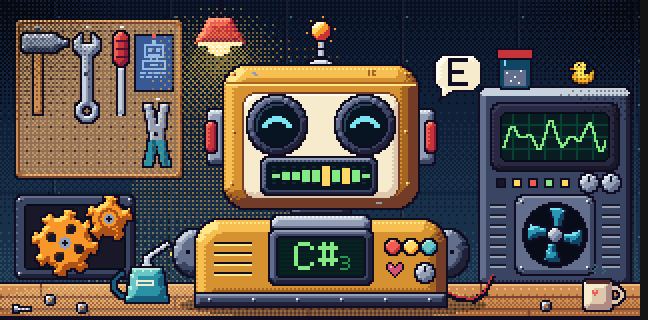

# Robo Voice

用吉他触发机器人说话。上方旋钮选它说话的音高，下方旋钮调金属感。

## 配套音频包

先安装音频包，再安装 App。

- Robo Voice Engine `org.resona.creative.robo-voice.voice` 1.0.0

## 两个编码器

| 页面／模式 | 上方旋转 | 上方短按 | 上方长按 | 下方旋转 | 下方短按 | 下方长按／按住 |
| --- | --- | --- | --- | --- | --- | --- |
| Robo Voice | 选机器人固定音高 C2～C4 | 元音说话开／关 | 无功能 | 调金属感 | 失真关闭／低保真／玩具语音 | 长按重置 |

## 项目详细说明

# Robo Voice

A robot on the workbench repeats everything you play in its monotone robot voice. Whatever notes
you pick, they come out on the robot's one note, spoken in vowels.

## Controls

| Control | Action | What it does |
| --- | --- | --- |
| SELECTOR | turn | NOTE: the robot's one note, C2 .. C4 (shown on its chest; it nods and hums the new note) |
| SELECTOR | click | TALK on/off: vowels that change on every pick, or a plain buzz |
| CUSTOMIZE | turn | METAL: metallic ring amount (painted, then steel, then chrome) |
| CUSTOMIZE | click | CRUSH: off / lo-fi / toy speech chip (its eyes get chunkier) |
| CUSTOMIZE | long press | reset |

Settings are saved.

## Controller

The Web and Mobile controllers, or any MIDI controller, play Robo Voice over MIDI channel 1;
CC 119 asks the App for every value. Four hold pads change its voice for as long as you hold
them (SHOUT wins over HISS).

| CC | Control | Values |
| --- | --- | --- |
| 20 | Note | 0..127 = C2..C4 (0..24 st) |
| 21 | Talk | 0 off, 1 on |
| 22 | Vowels (TALK amount) | 0..127 = 0..100 % |
| 23 | Harmony | 0 root, 1 octave, 2 power |
| 24 | Breath | 0..127 = 0..100 % |
| 25 | Metal | 0..127 = 0..100 % |
| 26 | Crush | 0 off, 1 lo-fi, 2 toy |
| 27 | Hum | 0..127 = 0..100 % |
| 28 | Mix | 0..127 = 0..100 % |
| 29 | Level | 0..127 = -12..+6 dB |
| 30 | SHOUT (hold) | 127 press, 0 release: chrome, toy crush, full vowels |
| 31 | HISS (hold) | all breath, full vowels, no metal or crush |
| 32 | CHORD (hold) | HARMONY POWER |
| 33 | HIGH (hold) | NOTE an octave up (up to C4) |

## The scene

- Mouth LEDs and the antenna bulb follow your playing; with TALK on a vowel pops up on each pick,
  with TALK off the mouth is one humming line.
- A very hard pick startles it: wide eyes, sparks from the antenna.
- Gears, the fan, the rack's lamps and its scope trace speed up with the playing.
- After 9 s of silence it goes to low power: the room darkens, eyes show "- -", the chest shows a
  flat battery.
- Chest display: the note name and octave; METAL's amount while that knob turns.

## DSP: Robo Voice Engine (`dsp/`)

    guitar -> 10 band envelopes --+
    saws at NOTE (+octave/fifth) + hiss -> 10 bands --x--> METAL ring mod -> TALK vowel formants
           -> gain matched to the guitar's own level -> CRUSH -> MIX -> limiter

A 10-band channel vocoder (120 Hz .. 5.6 kHz): the guitar only shapes the spectrum and dynamics,
the pitch is always the robot's. The wet level follows the guitar's own envelope, so it stays
level-matched across every setting.

| Parameter | Range | Notes |
| --- | --- | --- |
| NOTE | 0 .. 24 st | semitones above C2; glides, and hums briefly when changed |
| TALK | 0 .. 100 % | three vowel formants (A E I O U), a new random vowel on each pick or long hold |
| METAL | 0 .. 100 % | ring modulation at 2.756x and 5.404x the note |
| CRUSH | 0 .. 100 % | sample-rate and bit reduction, scaled to the playing level |
| MIX | 0 .. 100 % | |
| LEVEL | -12 .. +6 dB | |
| BREATH | 0 .. 100 % | high noise in the voice, so picks hiss like consonants |
| HARMONY | ROOT / OCTAVE / POWER | adds the octave, then the fifth |
| HUM | 0 .. 100 % | level of the hum on a NOTE change |

The knobs leave MIX 88, BREATH 30, HARMONY OCTAVE, HUM 60 and TALK 85 % (when on); the controller
sets each of them, and LEVEL.

## Build

    resona-lab build dsp            # checks the pack
    resona-lab pack build dsp
    resona-lab app build .
    python3 ../_art/robo_art.py     # re-bake src/art.h

## 开机动画

金色机器人亮起天线、睁开眼睛，嘴部电平随之点亮。 首次运行时保存到 Resona Box，下次开机播放。
